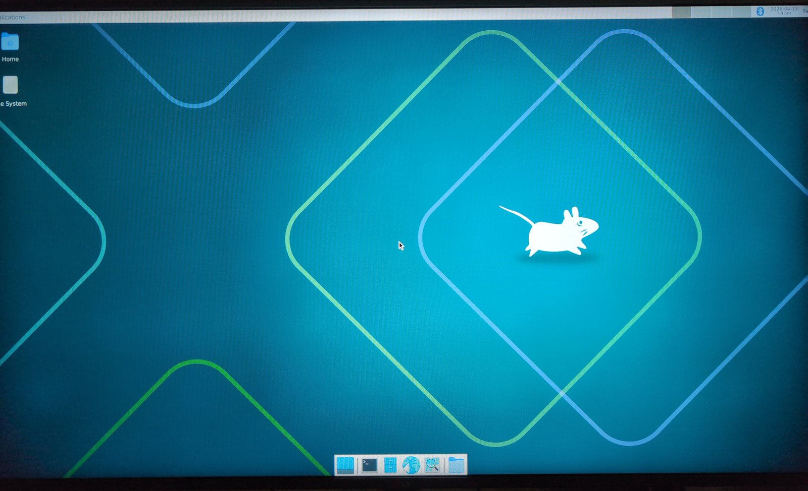
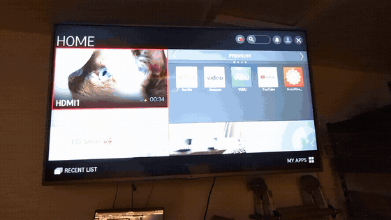

# ncplus

Mainline Linux 6.12 and Debian 13 on LG NetCast smart TVs from 2013-2014 (MediaTek MT5398).



The TVs have a dual Cortex-A9, a PowerVR SGX544 and 726 MB of RAM. LG shipped them with Linux 3.0.13
and glibc 2.12. This project runs a stock Debian armhf on them, with Xfce, Firefox and apt on the TV
panel. Its own drivers cover the display, USB host, sound, interrupt controller, second CPU and
watchdog.

Also here: [3D on the SGX544](#gpu), IMG's kernel driver ported to Linux 6.12 with OpenGL ES 2 on the panel.

> These TVs are easy to brick, permanently. Only boot another kernel on a TV where the
> [preflight check](#safety) passes, and read [Safety](#safety) first. No warranty, and no
> responsibility for bricked TVs.

## TL;DR

You need a root shell on the TV (telnet, see [openlgtv](https://github.com/openlgtv)), a TV that passes the
[preflight check](#safety), and a FAT32 stick of 8 GB or more.

1. Download the release zip, `netcast-debian.zip`, from the
   [releases page](https://github.com/ddagunts/ncplus/releases).
2. Extract the release zip such that the `netcast` folder goes to the root of the flash drive.
3. In `netcast/mainline/`, copy the example files and edit the copies. Both are optional:
   - `wifi.conf.example` to `wifi.conf`: network name and passphrase, for an AR9170 USB adapter ([Wi-Fi](#wi-fi))
   - `authorized_keys.example` to `authorized_keys`: your public SSH key ([SSH](#ssh))

   ```sh
   cd netcast/mainline                          # on the stick
   cp wifi.conf.example wifi.conf
   cp authorized_keys.example authorized_keys
   ```
4. Eject the stick, plug it into the TV with a USB keyboard and mouse, and run this in the TV's root shell:

   ```sh
   cd /mnt/usb/usb*/Drive1/netcast/mainline
   sh fire.sh probe                             # dry run, boots nothing
   nohup sh fire.sh go >/dev/null 2>&1 &        # boots Debian
   ```

The telnet session drops and the desktop is up in about a minute. `sudo reboot` goes back to LG's system.
The details are in [Getting started](#getting-started).

## What works

Tested on one TV (NetCast 4.5, firmware v04.03.10).

| | |
|---|---|
| CPU | both cores |
| Display | 1920x1080, KMS driver with tear-free page flips |
| Sound | TV speakers, 48 kHz stereo, through ALSA and PipeWire |
| USB | all four ports |
| Network | USB Ethernet. AR9170 USB Wi-Fi |
| Bluetooth | with a USB dongle. An LE keyboard works |
| GPU | OpenGL ES 2, off-screen and full screen. The desktop is drawn by the CPU |
| Desktop | Xfce on Xorg, Firefox ESR, VLC, compressed swap |
| Network shares | SMB 2.1/3 and NFS (v3, v4) clients. Built in 1.0, not tried on the TV yet |
| Backlight | on/off |
| Reboot, watchdog | both return to LG's system. The kernel log survives in RAM |

Not working: hardware video decoding, the LG remote, the tuner, the HDMI inputs and the built-in Wi-Fi

## Getting started

You need:

- a root shell on the TV (telnet, see [openlgtv](https://github.com/openlgtv))
- a TV that passes the preflight check (`fire.sh probe` runs it, see [Safety](#safety))
- a FAT32 stick of 8 GB or more
- a USB keyboard and mouse
- a USB Ethernet adapter, if you want a network

1. Extract the release zip, `netcast-debian.zip` (or [build it](#building)), such that the `netcast` folder
   goes to the root of the flash drive. Set up [SSH](#ssh) and
   [Wi-Fi](#wi-fi) now if you want them: copy the `.example` files in `netcast/mainline/` to
   `authorized_keys` and `wifi.conf` and edit the copies. Nothing reads the `.example` files themselves.
2. From LG's shell, do a dry run. It runs the checks and boots nothing:
   ```sh
   sh /mnt/usb/usb*/Drive1/netcast/mainline/fire.sh probe
   ```
3. Boot. The telnet session drops, and the desktop is up in about a minute (user `tv`):
   ```sh
   nohup sh /mnt/usb/usb*/Drive1/netcast/mainline/fire.sh go >/dev/null 2>&1 &
   ```

`sudo reboot` goes back to LG's system.

Unzipping a newer version leaves your `authorized_keys` and `wifi.conf` alone. A new `debian.img` replaces
the old one, including the packages you installed and the files you saved in it.

### SSH

You log in as **`root`**, with a key:

1. Make a key on your computer, if you don't have one: `ssh-keygen -t ed25519`
2. In `netcast/mainline/` on the stick, copy
   [`authorized_keys.example`](src/mainline/stick/authorized_keys.example) to `authorized_keys`, with nothing
   after the name (Windows may add a hidden `.txt`). Add a line to the copy with your public key, the contents
   of `~/.ssh/id_ed25519.pub`. One key per line, without a `#` in front. Never put a private key there.
3. Boot Debian, find the TV's address (`ip -4 addr` in a terminal on the TV, or your router's DHCP list), and:
   ```sh
   ssh root@192.168.1.50
   ```

Debian copies the file to root's keys at every boot. To add or remove keys, edit it and reboot. If it holds
only comments, the keys already in Debian are kept. The TV makes its own host keys at the first boot.

`root` has no password login. The desktop user `tv` has no password and no keys, so it can't log in over SSH.
To allow it, set a password with `sudo passwd tv`, or add your key to `/home/tv/.ssh/authorized_keys`. `tv` can
use `sudo` without a password, so a weak password there gives away root. From a root shell, `su - tv` switches
to the desktop user.

### Wi-Fi

This needs a USB adapter with an Atheros AR9170 chip, for example a Netgear WN111v2. The TV's built-in Wi-Fi
has no Linux driver. In `netcast/mainline/` on the stick, copy
[`wifi.conf.example`](src/mainline/stick/wifi.conf.example) to `wifi.conf` and fill in the copy:

```
ssid=My network
psk=my passphrase
country=US
```

- The name and passphrase are taken as written, without quotes. Remove the `#` in front of the lines.
- `psk` is 8-63 characters, or 64 hex digits. Leave it out for an open network. WPA2 and WPA3 use the same line.
- `country` is optional: two letters, for the radio rules where you are.
- For several networks or WPA-Enterprise, write a complete `wpa_supplicant.conf` in the file instead. A file
  with `network={` in it is used unchanged.

Plug in the adapter and boot. The address comes by DHCP, and Ethernet is preferred when both are connected.
In Debian the file is `/mnt/stick/netcast/mainline/wifi.conf`. After editing it, replug the adapter or reboot.
If it doesn't connect, check the log:

```sh
sudo journalctl -b -u 'netcast-wifi@*'
```

The passphrase is stored unencrypted on the stick.

### Network shares

```sh
sudo mkdir -p /mnt/share
sudo mount -t cifs //192.168.1.20/music /mnt/share -o username=me,uid=tv,gid=tv    # Samba or Windows
sudo mount -t nfs 192.168.1.20:/export/music /mnt/share                            # NFS
```

SMB 1 isn't built in. To mount at boot, put the share in `/etc/fstab` with `_netdev,nofail,x-systemd.automount`.

### Screen and backlight

Turn the backlight off now. A key press or mouse movement turns it back on:

```sh
DISPLAY=:0 xset dpms force off
```

Change the idle time before that happens by itself (default 20 minutes, here 5):

```sh
DISPLAY=:0 xset dpms 0 0 300
```

Switch the backlight directly, for example over SSH. The mouse won't wake this one:

```sh
echo 4 | sudo tee /sys/class/backlight/micom/bl_power    # off
echo 0 | sudo tee /sys/class/backlight/micom/bl_power    # on
```

Show plain black with the backlight on (Enter closes it). The mouse pointer stays visible:

```sh
DISPLAY=:0 xfce4-terminal --disable-server --fullscreen --hide-menubar --hide-borders \
  --hide-scrollbar --color-bg='#000000' --color-text='#000000' \
  -x sh -c 'printf "\033[?25l\033[2J"; read x'
```

If "off" fails, `bl_power` says `No such device or address` and `xset` says nothing, but `dmesg` has
`backlight off failed: -6`. Try again.

Boot at 50 Hz (untested), or at whatever rate LG's system is using, instead of 60:

```sh
NETCAST_HZ=50 nohup sh .../fire.sh go >/dev/null 2>&1 &      # or NETCAST_HZ=keep
```

## How it boots

LG's system starts normally, and its running kernel then hands over to Linux 6.12. LG built it without
kexec, so `nckexec` ([source](src/kmod/nckexec.c)) brings its own as a loadable module. Most of the work is
stopping the hardware cleanly first.

### Staging

`fire.sh` runs the preflight check and loads `nckexec`, which reads the kernel and device tree into
ordinary pages. The new kernel is copied to 0x8000, over the running one. The staging pages are
taken from above 16 MB, outside the area the copy overwrites.

### Setting the refresh rate

The panel keeps whatever rate it has at the jump. LG's home screen ran it at 50 Hz on the test
TV. Both modes use the same 148.5 MHz pixel clock, and only the number of lines changes:

| | Line | Frame | Rate |
|---|---|---|---|
| 60 Hz | 2200 pixels | 1125 lines | 148.5 MHz / (2200 x 1125) = 60.0 |
| 50 Hz | 2200 pixels | 1350 lines | 148.5 MHz / (2200 x 1350) = 50.0 |

Changing it by hand would mean rewriting the porches, sync positions and interrupt lines along with the
total. LG's driver already does that: its media player forces 60 Hz through an ioctl on `/dev/mtal`, and
[`ncrate`](src/tools/ncrate.c) makes the same call. The driver keeps a forced rate when it
recalculates, so changing screens doesn't undo it.

`ncrate` then times the panel's live line counter to check that the rate changed. It also has to
wait for the picture. The driver fades every on-screen layer out for ten frames around a switch, and a
jump in that window can leave Linux with a black screen. (Forcing 50 gives 51.4 Hz, because the force also
starts LG's clock-tracking loop with no video input to track. `ncrate` notices and uses a different call.)

### Stopping the CPUs

`nckexec` runs the kernel's normal reboot notifiers and device shutdown, then deals with the second core.
LG's own way to park CPU1 is a loop inside LG's kernel, which is about to be overwritten. So a thread
pinned to CPU1 turns interrupts off and jumps into a 320-byte stub in a reserved page. The stub flushes
the cache, switches the MMU off, stops that core's timer and interrupt interface, writes "waiting" into
the page and sleeps in WFE. Later, mainline's SMP code
([platsmp.c](src/mainline/kernel/arch/arm/mach-mt5398/platsmp.c)) writes an entry address next to it and
sends an event. If the page doesn't say "waiting", Linux leaves CPU1 alone and runs on one core.

### Stopping USB and the GPU

LG's USB driver has no shutdown hook. The built-in Wi-Fi sits on USB with a receive DMA always armed, so
it could write packets into memory the new kernel owns. With interrupts off, `nckexec` clears all sixteen
DMA channels.

The GPU runs its own firmware, and that kept running after the jump. It incremented a word of memory
that Linux owned, a thousand times a second. The symptom was two or three changed bytes in a shared
library. `nckexec` now waits for the GPU to go idle and holds it in reset. The GPU driver
releases it when it loads.

### Taking the panel

LG's UI is a 1280x720 picture that a hardware scaler stretches to the panel. The display engine doesn't
take a framebuffer address from a register. Each layer points at a small header in RAM, which it fetches
every frame, and the header says where the pixels are and what shape they have.

So taking the screen means editing that header: 1920x1080, a buffer at 0x25800000 filled with black, and
the scaler set to 1:1. This happens with interrupts off, so LG's vsync handler can't flip its own picture
back. LG's UI is sometimes on another layer. In that case `nckexec` switches the other layers off and
writes a header of its own. The timing generator is left running, so the panel never loses sync.

### The jump

`nckexec` maps memory 1:1, flushes both cache levels, and branches to a copy loop that uses no stack and
no kernel code, since the copy overwrites the old kernel. It turns the MMU off, copies the new kernel over
the old one and enters it.

### In Linux

The display driver ([mt5398_osd.c](src/mainline/kernel/drivers/gpu/drm/tiny/mt5398_osd.c)) takes over the
header. A page flip rewrites one word of it, so it can't tear. No vsync interrupt is known for this block,
so vblank is a timer that reads the panel's line counter on every tick and re-arms itself for the right
line. The hardware also shows which header it fetched last. The driver uses that to confirm each flip and
to learn, from the first eight, on which line the fetch happens.

The initramfs finds `debian.img` on the stick, mounts it, arms the watchdog and starts systemd. A watchdog
reset doesn't clear RAM on this TV, so after a crash LG's system can read back the dead kernel's log.

The register-level detail is in [FINDINGS.md](FINDINGS.md) and [docs/sgx544.md](docs/sgx544.md).

## GPU

3D works on the SGX544: OpenGL ES 2 programs run on the hardware, render straight into the display's buffers and
flip them on the panel without tearing. The Xfce desktop doesn't use it.

No open driver supports this core yet, so this uses IMG's. The kernel module is TI's release of DDK 1.9
(MIT/GPL-2.0), changed until every shared structure and ioctl matched LG's build, and ported to 6.12. The
OpenGL ES libraries are the TV's own. `fire.sh` copies them from the TV to the stick, and they are never
shipped here.

### What it can do

| | |
|---|---|
| APIs | EGL 1.4, OpenGL ES 2.0, GLSL ES 1.00 with the shader compiler on the TV (`PowerVR SGX 544MP`, build 1.9@2291151) |
| Off-screen rendering | pbuffers, read back with `glReadPixels` (slow: 260 ms for a 1280x720 frame) |
| On screen | 1920x1080 full screen, 2 to 4 KMS buffers that the GPU renders into without a copy, tear-free flips at the panel's rate |
| Waiting for the GPU | real: `eglSwapBuffers` hands over a buffer only when the GPU has finished it |
| Textures | RGBA and BGRA 8888, RGB565 |

The driver also reports these. Nothing here has tested them:

- textures: ETC1, PVRTC and PVRTC2 compression, float and half-float, depth, non-power-of-two
- 24-bit depth and packed depth/stencil, multisampled render to texture
- vertex array objects, 32-bit indices, standard derivatives, high precision in fragment shaders
- program and shader binaries, EGL fences, EGLImage

### Speed

Measured on the TV, with every result checked by reading pixels back:

| | |
|---|---|
| Blended or textured fill, 1280x720 | 550-590 Mpixel/s |
| Triangles, 240,000 per frame | 4.0 M/s |
| Simple 1080p frame rendered into a display buffer | 4 ms (230-250 fps) |
| Page flips at 60 Hz, 60 s | no late frames once the driver had learnt the timing |
| Texture upload, 1080p RGBA | 24 ms (a CPU copy to the screen takes 12.6 ms) |
| Texture upload, 1080p RGB565 / 720p RGBA | 12 ms / 10.5 ms |
| Texture upload, 512x512 / 256x256 RGBA | 3.5 ms / 0.8 ms |

A 1080p RGBA upload takes longer than a refresh (24 ms against 16.7 ms at 60 Hz), which is why the desktop stays on
the CPU. Programs that keep their textures on the GPU avoid this cost.

### What it can't do

- **armel programs only.** LG's libraries are soft-float, so a GPU program has to be built for armel. Debian's own
  (armhf) programs can't load them. The armel C library is in the image.
- **No desktop integration.** The driver doesn't support X11, Wayland, GBM, DRI or Mesa. The desktop has no GPU windows
  and Firefox has no WebGL. Pixmap surfaces are refused.
- **On screen means full screen**, with the desktop stopped.
- It doesn't support ES 3, desktop OpenGL, Vulkan, OpenCL or video decoding.
- OpenGL ES 1.1 is copied along but untested.

### Using it

The driver isn't loaded at boot. This loads it, starts the GPU and runs an off-screen test. Results go to
`pvrtest.log` and `frame.ppm` next to the script:

```sh
sudo sh /mnt/stick/netcast/mainline/pvr/pvrtest.sh
sudo sh -c 'cd /run/pvr && LD_LIBRARY_PATH=/run/pvr ./sgxgltest -b'    # then the benchmark
```

To run that test at every boot, create an empty file `netcast/mainline/pvrtest` on the stick. If the GPU hangs the TV,
the watchdog brings LG's system back.

The other tests are built by `third_party/build-sgx.sh` and aren't in the zip. Copy them to `/run/pvr` and run
them as root the same way: `sgxscan` (rendering into display buffers, nothing shown), `sgxupload` (upload speed) and
`sgxflip` (animation on the panel, after `sudo systemctl stop lightdm`).

To write your own, start from [`sgxflip.c`](src/mainline/sgx/test/sgxflip.c). It allocates KMS buffers, describes them in
a [`struct netcast_window`](src/mainline/sgx/wsegl/netcast_window.h) and passes that to `eglCreateWindowSurface`. The
callback in it gets each finished frame. Details are in [docs/sgx544.md](docs/sgx544.md).

## Building

On x86-64 Linux (tested on Debian 13), with `mmdebstrap` and `qemu-user-static` installed, and the openlgtv
toolchain from [Building ncplus](docs/ncplus.md#building-ncplus).

```sh
third_party/build-deps.sh kmod                # Bootlin toolchain, LG's GPL kernel source, nckexec.ko
third_party/build-mainline.sh                 # Linux 6.12.119 + MT5398 drivers
TMPDIR=/var/tmp third_party/build-debian.sh   # Debian 13 root image
third_party/build-sgx.sh                      # GPU module and tests
make -C src                                   # tools for LG's system
build/package-debian.sh                       # -> dist/netcast-debian.zip
```

## ncplus on LG's own system

The project started as native apps on LG's firmware: a launcher, Doom, RetroArch, a video player, a
terminal, a remote-control API with a Home Assistant integration, and others. They are
built separately. See [docs/ncplus.md](docs/ncplus.md).



## Repository layout

| Path | |
|---|---|
| `src/mainline/` | the mainline system: kernel config, DTS, MT5398 drivers (`kernel/`) and patches, the initramfs, the Debian overlay, the example `authorized_keys` and `wifi.conf` (`stick/`), `fire.sh` |
| `src/mainline/sgx/` | the GPU driver: patches to TI's DDK 1.9 kernel module, the MT5398 system layer, EGL window-system module, tests (`sgxgltest`, `sgxscan`, `sgxflip`, `sgxupload`) |
| `src/kmod/` | kernel modules for LG's 3.0.13 kernel: `nckexec` (warm boot into the mainline kernel, with the display, CPU1 and GPU hand-off), `xpadone` |
| `src/libnc/` | the native runtime: HOA registration, window, EGL, input, text (FreeType), 2D helpers |
| `src/apps/` | launcher, photos, player, music, network shares, settings, terminal, demos, `ncscreen`, `nclite`, `run-app.sh` |
| `src/tools/` | `ncapi` (remote API), `ncnosleep`, `ncnetkeep`, `nckey`, `evdump`, `ncpreflight` (read-only check before booting another kernel), [`ncdebug`](#why-ncdebug-is-included) (debug level), `ncrate` (panel refresh rate), `wlq`/`pktlog` (Wi-Fi diagnostics), plus `peek`/`sniff` (ptrace helpers used for reverse engineering) |
| `src/stubs/` | export lists of the TV's `libEGL`/`libGLESv2`, used to generate link stubs |
| `src/qml/` | QML apps (static Qt 6 + `eglfs_netcast`) |
| `package/apps/` | per-app launch scripts, configs and `app.ini` files copied into the package |
| `third_party/` | `build-mainline.sh`, `build-debian.sh`, `build-sgx.sh`, `build-deps.sh` (pinned versions + checksums), the SDL2 and qtbase patches, RetroArch/Qt build scripts, vendored stb, dr_libs and Khronos headers |
| `build/` | package builders (`package-debian.sh`, `package.sh`), chroot image builder (+ BusyBox config) |
| `usb/netcast/` | chroot helpers (`enter.sh`, `teardown.sh`) for the optional userland image |
| `tools/` | host-side helpers (`tv.py`, `push.sh`, `pull.sh`, `pull-glibc.sh`, `netwatch.sh`, `kmod-check.sh`, `tv-dump-flash.sh`, `unlz4p.py`). `apitest.sh` and `hatest.sh` test the API and the Home Assistant integration |
| `custom_components/netcast_plus/` | the Home Assistant integration. Its tests are in `tests/ha/` |
| `docs/` | [`ncplus.md`](docs/ncplus.md), [`home-assistant.md`](docs/home-assistant.md), GPU and display notes in [`sgx544.md`](docs/sgx544.md) |
| `FINDINGS.md` | the technical notes |

## Safety

- Nothing here writes the TV's flash. Kernels are started from RAM, Debian lives in a file on the stick, and
  changes to LG's running system are lost at power-off. The exceptions are tools that say so:
  `ncdebug set`/`toggle` write the NVM EEPROM, and LG's service menu (`nckey instart`) saves what you change in it.
- A kernel that misbehaves can leave these TVs permanently unbootable, with no way to recover. `fire.sh` runs
  `ncpreflight` (read-only) first and refuses on a TV that doesn't pass. Most retail sets don't: they are
  in RELEASE, and the check asks for [DEBUG](#what-debug-does). Don't bypass it.
  If your TV needs help passing the preflight check, join the #netcast channel on the openlgtv Discord.
- The firmware-specific tools check what they're talking to and refuse on other builds.

### What DEBUG does

When the TV starts, its boot loader checks the signatures of LG's software as it reads it from the memory chip. If a
check fails at the factory setting, RELEASE, it stops and first burns a fuse inside the main chip. A fuse can't be
restored. From then on the boot loader runs a stricter check at every start, which can keep a TV from ever starting
again. At the DEBUG level it stops, but **doesn't burn the fuse**, so the hardware isn't permanently changed.

The boot loader can't tell why a check failed. It makes no difference whether

- someone unknown broke into the TV and tampered with its software,
- the owner was experimenting with their own TV, or
- the memory chip is failing and returned corrupt data, without anyone having done anything.

In RELEASE each of these can end the life of otherwise working hardware. DEBUG is there to prevent that, and so to
extend the life of the TV.

What DEBUG doesn't do:

- It doesn't turn the signature checks off. A TV that fails one still stops, and doesn't start until the cause is fixed.
  DEBUG leaves a way to do that: the service console on the TV's serial port, which RELEASE locks.
- It doesn't undo a fuse that is already burnt, and it doesn't repair a failing memory chip.
- A bad fast-start snapshot makes the TV stop in DEBUG and needs the serial console. RELEASE clears it by itself.
- It opens the serial console to anyone who has physical access to the inside of the TV.

This comes from LG's published boot loader source and from reading the TV's own boot loader. A failed check was not
provoked on a real TV.

### Why `ncdebug` is included

These TVs are more than ten years old, and the people who own them should be able to decide what runs on them.

- The factory software is out of date. It runs Linux 3.0.13, a kernel series that stopped getting upstream fixes in
  2013, with glibc 2.12 from 2010. On the test TV, LG's last kernel build is from May 2017.
- A failed check at boot shouldn't permanently damage someone's TV, whatever caused it ([What DEBUG does](#what-debug-does)).
- The hardware still works. With a maintained system it can stay useful and get security updates, instead of
  being thrown away.
- [`ncdebug`](src/tools/ncdebug.c) lets an owner read the TV's debug level, and change it, with their own root shell and
  no soldering. It doesn't modify LG's software and contains none of it.

`ncdebug status` is read-only. `set` and `toggle` are dry runs without `--yes`. With it they write one byte of the
settings EEPROM, which takes effect at the next power cycle. It has only been tried on one TV: on another model,
stop if `status` or the dry run complains. Use it on a TV you own, at your own risk.

## Credits

[Linux](https://kernel.org) (GPL-2.0) · [Debian](https://www.debian.org) · Imagination Technologies' PowerVR DDK 1.9 kernel module as released by [Texas Instruments](https://git.ti.com/cgit/graphics/omap5-sgx-ddk-linux/) (Dual MIT/GPL-2.0) ·
[Chocolate Doom](https://github.com/chocolate-doom/chocolate-doom) (GPL-2.0) ·
[Freedoom](https://freedoom.github.io) (BSD) ·
[OpenTyrian](https://github.com/opentyrian/opentyrian) (GPL-2.0, Tyrian 2.1 data is a freeware release by its author) ·
[RetroArch](https://www.retroarch.com) and libretro cores (GPL, except that Genesis Plus GX and Snes9x 2005 are non-commercial) · [240p Test Suite](https://github.com/ArtemioUrbina/240pTestSuite) (GPL-2.0) ·
[libsmb2](https://github.com/sahlberg/libsmb2) (LGPL-2.1) · [dr_libs](https://github.com/mackron/dr_libs) (public domain / MIT-0) ·
[LVGL](https://lvgl.io) (MIT) · [libvterm](https://www.leonerd.org.uk/code/libvterm/) (MIT) ·
[FreeRDP](https://www.freerdp.com) (Apache-2.0) · [Qt](https://www.qt.io) (LGPL-3.0) · DejaVu fonts ·
[SDL](https://libsdl.org) and SDL2_ttf (zlib) · [stb](https://github.com/nothings/stb) (public domain) · FreeType ·
[openlgtv / buildroot-nc4](https://github.com/openlgtv/buildroot-nc4) and the openlgtv community.

## License

ncplus's own code is under the [MIT License](LICENSE). Exceptions:

- The kernel modules in `src/kmod/` and the mainline drivers and patches in `src/mainline/` are [GPL-2.0](LICENSES/GPL-2.0.txt).
  The device tree is GPL-2.0 OR MIT.
- The GPU driver's files in `src/mainline/sgx/` are GPL-2.0 OR MIT, like the DDK they patch.
- The patches in `third_party/patches/` follow the license of the project they modify (zlib for SDL, LGPL for
  FFmpeg, GPL-2.0 for NetSurf, LGPL-3.0/GPL for Qt).
- The vendored stb, dr_libs and Khronos headers keep their own licenses.
- Bundled third-party programs keep theirs. The USB package lists them in `netcast/LICENSES/`.

LG firmware, libraries, keys and flash dumps are not included here or in the release packages.

Not affiliated with or endorsed by LG Electronics, MediaTek or Imagination Technologies. LG and NetCast are
names or trademarks of LG Electronics, used only to identify the TVs this works with. Other names belong to their
owners. Provided as is, without warranty of any kind. The authors take no responsibility for bricked or damaged
TVs. These TVs are easy to brick. Use at your own risk.
