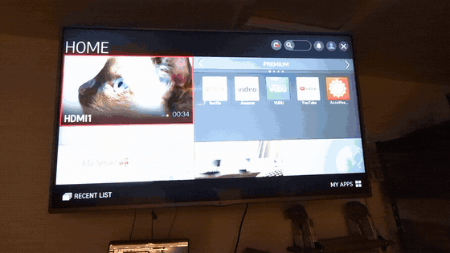
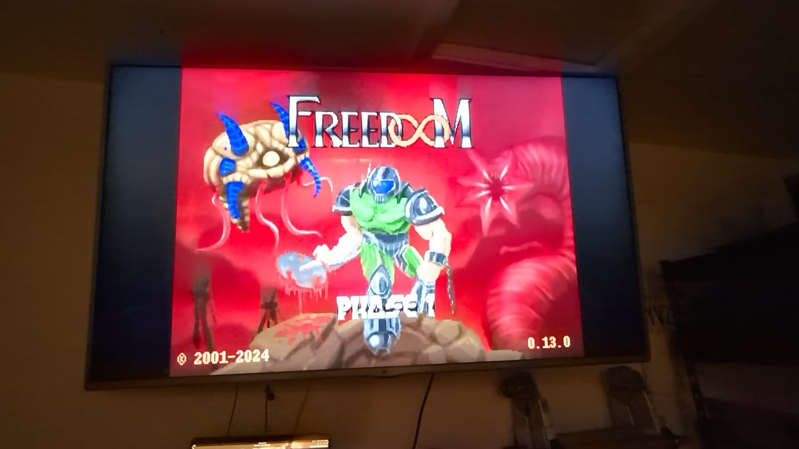

# ncplus on LG's own system

The earlier part of the project. The main [README](../README.md) is about the Debian system.

Before the mainline port, this project ran on LG's stock firmware and Linux 3.0 kernel, next to
LG's software. It has these parts:

- a native userland (GCC 16, Python 3.14, SDL2, GStreamer 1.24) cross-built against the TV's own glibc
- native GPU-accelerated apps in a window from LG's process manager
- an SDL2 port
- a new home screen
- control of the TV itself (backlight, sleep timers, LG services)

LG's TV stack (tuner, HDMI, picture processing) keeps running underneath. ncplus still works and is
built separately (`build/package.sh` -> `dist/ncplus.zip`).



[](media/doom-on-lg-netcast.mp4)

▶ [Video (H.264, 720p)](media/doom-on-lg-netcast.mp4)

## What it does with the TV

| Area | What ncplus does | How |
|---|---|---|
| **Display** | Full-screen 1280x720 GLES2 window above LG's UI, opaque or deliberately see-through over live TV | LG's HOA window API + PowerVR EGL, framebuffer alpha controlled per frame |
| **Input** | Remote, USB keyboards/mice (hot-plug), gamepad | Linux evdev. Remote buttons map to standard keys (Back = Escape, colour keys = F1-F4). Volume keys change LG's volume |
| **Audio** | PCM from SDL apps, paced about 100 ms ahead | MediaTek `mtkaudiosink` (GStreamer 0.10) via a new SDL audio driver |
| **Screen power** | Backlight off/on while the TV, Wi-Fi and apps keep running | LG's MICOM power controller over I2C, using the same command LG's Screen Off uses (reverse-engineered) |
| **Screen saver** | Backlight off after N minutes without input. Any key wakes it | `ncscreen saver` daemon |
| **Stay awake** | Disables LG's Auto Off / No-signal / No-operation power-off timers | Patches LG's in-RAM settings copy (RAM only, never saved) |
| **Resources** | Stops unneeded LG services (browsers, voice, Skype, DIAL...) | LG's own process-manager API |
| **Wi-Fi** | Keeps the TV reachable (stock firmware drops off the network for ~5 min every ~20 min) | `ncnetkeep` ARP keep-alive: the Wi-Fi firmware never delivers broadcasts, so the router's ARP entry ages out |
| **Remote control** | HTTP API on the LAN for remote keys, ncplus apps, settings and screen on/off, with a Home Assistant integration on top | `ncapi` (bearer token, Settings > Remote API) + [`custom_components/netcast_plus`](../custom_components/netcast_plus/) |
| **Video** | Hardware H.264/MPEG decode on the video plane, our UI composited on top | GStreamer 0.10 `playbin2` + MediaTek `mtkvideosink` |
| **Userland** | Toolchain, Python, a shell environment | Buildroot (openlgtv buildroot-nc4) on LG's glibc, optional chroot image |
| **Kernel** | Extra modules for the stock kernel (gamepads first) | Vanilla 3.0.13 built to the TV's vermagic (insmod pending a layout check) |

### Apps

| App | |
|---|---|
| **Launcher** | ncplus home screen. Apps are folders with an `app.ini` |
| **Doom** | Chocolate Doom + Freedoom: Phase 1, with sound and OPL music, playable on the remote |
| **Tyrian** | OpenTyrian (optional freeware data) |
| **Photos** | Browses an HTTP server (e.g. `python3 -m http.server`): thumbnail grid, prefetch, EXIF rotation, slideshow |
| **Network Shares** | SMB2/3 browser (libsmb2) for NAS/Windows shares and the USB stick. Opens music, photos and video in the other apps |
| **Music** | FLAC (incl. 24-bit/96 kHz), MP3 and WAV with tags, cover art, playlist, seek, shuffle/repeat. Plays from the stick or SMB |
| **Player** | Hardware-decoded video (H.264, MPEG-2 and MPEG-4, with MP4, MKV, TS and FLV containers) from files, HTTP, RTSP or UDP streams, using the TV's own decoders |
| **RetroArch** | RetroArch 1.22 (GLES2) with NES, SNES, Game Boy, GBA, Mega Drive and PlayStation cores |
| **Settings** | LVGL 9 settings screen: screen saver, keep-awake, lite mode, Wi-Fi keep-alive, screen off, system info |
| **Terminal** | libvterm terminal (USB keyboard) for the TV shell or the chroot userland |
| **Remote Desktop** | FreeRDP 3 (SDL2 client) for Windows or xrdp desktops |
| **QML Hello** | Qt 6 / QML on the TV through an `eglfs_netcast` platform plugin (in progress) |
| **SDL Demo / Input Test** | GPU, audio and input demos |

## How it works

```
                 ┌──────────────────────── USB stick (FAT32) ────────────────────────┐
                 │  start.sh ─ launcher ─ apps (Doom, Tyrian, Photos, ...)            │
                 │                 │                                                  │
                 │        SDL2 (netcast video + audio)       tools: ncscreen,         │
                 │                 │                          ncnosleep, nclite       │
                 │               libnc  (register app, window, EGL, input, logging)   │
                 └─────────────────┼──────────────────────────────────────────────────┘
   LG userspace (stock, untouched) │
     procmgr ── window ID ─────────┤  HOA API (libafopenapi) over D-Bus
     RELEASE (TV process) ─────────┤  settings in RAM (ptrace), MICOM I2C protocol
     PowerVR EGL/GLES2 ────────────┤  native window = HOA window ID
     GStreamer 0.10 mtkaudiosink ──┘
   Kernel 3.0.13 (stock) ── /dev/mtal (MediaTek), /dev/pvrsrvkm (GPU), /dev/input/event*
```

The main steps, reverse-engineered from LG's binaries without LG headers or an SDK:

1. **Become an LG app.** Copy the environment `procmgr` gives its apps, register with
   `HOA_PROC_RegisterService` (it reads `PM_EXECARGS`, not argv), and get the window
   `procmgr` assigns. The **EGL native window is that window ID.**
2. **Contain LG's libraries.** Initialise LG's debug framework first and keep its crash and
   stdout hooks out of our processes. Redirect every path LG would write to flash
   (`HOME`, the GStreamer registry, the app-framework mask) into RAM or onto the USB stick.
3. **Use LG's paths to the hardware.** PCM goes through MediaTek's GStreamer sink.
   Backlight commands go over the MICOM's I2C bus, using the bytes LG's TV process
   sends, captured live with ptrace.

Details, gotchas and addresses are in **[FINDINGS.md](../FINDINGS.md)**.

## Getting started

Requirements: an LG NetCast 4.x TV with a root shell (telnet), and a FAT32 USB stick.
Getting that root shell is model- and firmware-specific and is not covered here. See the
[openlgtv](https://github.com/openlgtv) community.

1. Download `ncplus-<version>.zip` from [Releases](https://github.com/ddagunts/ncplus/releases)
   (or build it, see [Building ncplus](#building-ncplus)) and unzip it onto the root of the stick.
   You get a `netcast/` folder.
2. Plug the stick into the TV.
3. From the TV's shell:
   ```sh
   sh /mnt/usb/usb*/Drive1/netcast/start.sh      # ncplus launcher (detaches)
   ```
   (The stick is mounted as `usb1` or `usb2`, depending on the port.)

`start.sh` switches LG's sleep timers off (in RAM), starts the screen saver and the Wi-Fi
keep-alive, and shows the launcher. Arrows move, OK launches and **Back is back/menu**. Volume and mute work inside apps.
"Exit to TV" returns to LG's home screen.

Tools on the stick (`netcast/tools/`):

```sh
ncscreen off --wake        # backlight off until any key is pressed
ncscreen saver 20          # screen saver: dark after 20 min idle
ncnosleep status|off       # LG power-off timers (RAM only)
nclite stop|start|list     # stop / restart optional LG services
ncnetkeep [-t 30] [-v]     # Wi-Fi keep-alive (start.sh runs it; NETKEEP=0 in netcast.conf turns it off)
```

Developer tools (`make -C src out/<tool>`, not in the package):

```sh
nckey instart              # inject a remote key, e.g. open LG's In-Start service menu (code 899)
evdump 30                  # print every input event for 30 s
ncpreflight                # read-only: may this TV boot another kernel?
ncdebug status             # read LG's debug level; set/toggle write the settings EEPROM
```

### Remote API and Home Assistant

Settings > **Remote API** starts `ncapi` on port 9080 and shows the address and token. The token is 32 hex
characters, kept in `netcast.conf` `[api] TOKEN`. "New token" replaces it. Every request needs
`Authorization: Bearer <token>`. It is plain HTTP, so the token crosses the LAN in the clear.

```sh
T=<token>; TV=http://<tv-ip>:9080/api/v1
curl -H "Authorization: Bearer $T" $TV/status                        # app in front, screen on/off, version
curl -H "Authorization: Bearer $T" -d '{"key":"volup"}' $TV/key      # any remote key (GET /keys lists names)
curl -H "Authorization: Bearer $T" -d '{"app":"doom"}' $TV/launch    # an app id, "launcher" or "exit"
curl -H "Authorization: Bearer $T" -X PUT -d '{"SAVER_MIN":30}' $TV/settings
curl -H "Authorization: Bearer $T" -d '{"on":false}' $TV/screen      # backlight off; any key turns it on
```

The endpoints are listed at the top of [`src/tools/ncapi.c`](../src/tools/ncapi.c). `tools/apitest.sh` checks them.
The **Home Assistant** integration (`netcast_plus`) turns this into a TV media player (volume, mute,
ncplus apps as sources, screen off/on), a remote for `remote.send_command`, switches and a select for
the settings, and a current-app sensor. See [docs/home-assistant.md](home-assistant.md).

> **Careful in LG's service menu.** Changes under Tool Option, Area Option, ADC or White Balance are
> saved permanently. `nckey` refuses codes 897/898 (IN-STOP / power-only), which reset the TV to its
> shipping state.

## Building ncplus

ncplus cross-compiles on an x86-64 Linux host (tested on Debian 13). You need `curl`, `git`,
`unzip`, `python3`, `patch`, a host `gcc`/`make`, and `fonts-dejavu-core` (the UI fonts are copied from
`/usr/share/fonts`). The build needs no files from LG. EGL/GLES2 are linked against stubs generated from
the TV libraries' export lists (`src/stubs/`).

```sh
# 1. Toolchain: the openlgtv buildroot-nc4 SDK (release 2026.08-webos, "arm-lgtv-linux-gnueabi"),
#    unpacked and relocated to toolchain/arm-lgtv-linux-gnueabi_sdk-buildroot/
#    https://github.com/openlgtv/buildroot-nc4/releases
# 2. Third-party libraries and apps: fetched at pinned versions, checksummed, cross-built
third_party/build-deps.sh             # SDL2 (+ netcast patch), SDL2_mixer/ttf, libsmb2, libvterm, LVGL,
                                      # Chocolate Doom + Freedoom, OpenTyrian, FreeRDP, RetroArch + cores
# 3. ncplus itself
make -C src                           # libnc, launcher, apps, tools
# 4. The USB package
build/package.sh                      # -> dist/ncplus.zip
build/package.sh --with-tyrian-data   #    ... with the Tyrian 2.1 freeware data (see its EULA)
build/package.sh --release            #    ... as published: no chroot image or Tyrian data; xpadone.ko only
```

Optional:

```sh
third_party/build-deps.sh kmod        # vanilla 3.0.13 with the TV's vermagic + src/kmod modules
third_party/qt/fetch.sh && third_party/qt/build-host.sh && third_party/qt/build-target.sh   # Qt 6 (WIP)
tools/pull-glibc.sh && build/build-image.sh   # chroot image with the full userland (needs LG's glibc
                                              # from your TV) -> usb/netcast/
```

Host tools talk to the TV over telnet. Put its IP address in `tools/.tv-host` (or set `NETCAST_TV`).
`tools/tv.py 'cmd'` runs a command, `tools/push.sh <subdir> files...` uploads into the stick's
`netcast/` folder through a temporary BusyBox `ftpd` confined to the stick, and `tools/pull.sh` copies a
file back. `make -C src deploy` uploads all apps.
